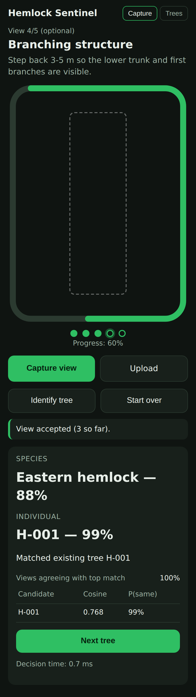

# Hemlock Sentinel

**Status: prototype** (branch `prototypes/hemlock-sentinel`).

Hemlock Sentinel is a handheld system for identifying and monitoring individual
**Eastern hemlocks** (*Tsuga canadensis*) in North Georgia. A plain classifier
can say *"this is an Eastern hemlock."* Hemlock Sentinel answers a harder
question: *"this is the same physical tree we recorded as H-017 last October."*
It then stores the new observation in that tree's history for later change
detection.

```
Species:     Eastern hemlock — 97%
Individual:  H-017 — 94%
```

The user takes 3–5 guided photos (trunk from the north side, two quarter-turns
around the tree, then optionally branching and canopy). Depth is used when
available. The system:

1. checks image quality and blurs any faces;
2. runs one shared **DINOv2-S/14 → GeM → BatchNorm** network per view, which gives a species prediction and a 384-d identity embedding. The design started from MiewID's EfficientNetV2-M recipe; DINOv2-S replaced EfficientNetV2-M after controlled experiments roughly doubled test mAP. The GeM → BN head and sub-center ArcFace loss are kept;
3. refuses to assign an ID unless the species is supported and above a **validated** confidence threshold;
4. averages the views into one tree embedding and runs a cosine search over every stored observation;
5. scores the top candidates with global similarity, view agreement and, optionally, local bark keypoints and trunk structure from depth, using a **calibrated** model fitted on validation data;
6. decides **existing tree**, **new tree** (gets the next persistent ID, e.g. `H-158`), or **uncertain** (contradicting views: take another view, or the user decides);
7. persists the observation (SQLite + content-addressed files) so the tree's history accumulates.

How it works: [`docs/architecture.md`](docs/architecture.md).
Why each part exists: [`docs/research/literature_review.md`](docs/research/literature_review.md).
What was measured: [`docs/experiments.md`](docs/experiments.md).
Running on a Raspberry Pi: [`docs/deployment.md`](docs/deployment.md).

## What the evidence does and does not support

* All hemlock numbers come from **BarkNet 1.0** (MIT): 45 hemlocks, about 22 bark photos each, all from **one session per tree**. They measure "same tree, new bark region, same day" on trees never seen in training. The test set is 14 hemlocks, so confidence intervals are wide.
* **Cross-season re-identification has not been tested.** No openly licensed dataset with repeat visits of individual hemlocks exists that we could find. The app is built to collect one.
* Depth matching is implemented and tested only on **simulated** trunks. It stays off until it is calibrated on real field depth.

## Results at a glance

Hemlock test trees never seen in training (14 trees, BarkNet, same-session regime). Details and confidence intervals are in [`docs/experiments.md`](docs/experiments.md).

| | Production (DINOv2-S/14) |
|---|---|
| Recognise a returning tree from 3 trunk views: top-1 / top-5 among enrolled trees | **0.86 / 0.997** |
| … from 5 views | 0.94 |
| Fully automatic decision at the shipped calibration: returning trees auto-accepted / new trees falsely matched | 43 % / **0.6 %** |
| Species gate: accuracy; hemlock precision / recall; never-seen red spruce called hemlock | 93 %; 0.99 / 0.99; 1 of 236 |
| ONNX model / RAM / time per view (x86 4-core dev box, not a Pi) | 87 MB / 273 MB / 117 ms |

When not confident enough to auto-accept, the app does not guess. It either:
* asks for extra trunk views (when views disagree), or
* shows the ranked candidates for one-tap confirmation; the correct tree is in the top 5 for 99.7 % of returning-tree queries here.



*The capture app running the trained model: a held-out BarkNet hemlock enrolled as H-001 and recognised on a revisit with different photos.*

## Repository layout

```
src/hemlock_sentinel/
  acquisition/   hardware interfaces + mocks, device adapters, guided protocol, quality checks, face blur
  species/       species labels, gated species decision
  reid/          backbone, GeM, embedding net, losses, multi-view aggregation, retrieval,
                 local matching (RootSIFT, trunk profile), calibration, fusion/decision
  database/      SQLite schema, repository (persistent IDs), in-memory index
  pipeline/      end-to-end inference, model runtimes (ONNX / Torch / Mock)
  evaluation/    leakage-safe splits, metrics, open-set protocols
  app/           FastAPI server + single-page guided-capture UI
training/        reid/ (trunk caching, tail fine-tuning, aggregator ablation), species/
scripts/         data prep, evaluation, calibration, export, ablations
benchmarks/      inference and retrieval benchmarks
tests/           unit / numerical / integration / end_to_end
docs/            architecture, deployment, experiments, research/
```

## Setup

```bash
python -m pip install -e ".[torch,onnx,app,dev]"      # Python >= 3.10
pytest -q -m "not slow"                                 # fast suite (no weights needed)
pytest -q                                               # + training/export regression (downloads ImageNet weights)
```

## Try the app (demo mode, no trained model)

```bash
hemlock-app --port 8000        # open http://localhost:8000 — banner says DEMO (mock model)
```

Phones only give web pages camera access over HTTPS (or localhost). See
`docs/deployment.md` for `--ssl-certfile/--ssl-keyfile`. Without HTTPS, the
"Upload" button still uses the phone camera through the file picker.

## Reproduce the results

```bash
# 1. data: BarkNet 1.0 (Zenodo 11508014, MIT), species used: PRU PIB PIR PID HEG ERR ERB PEG (+ THO, EPR held out)
python scripts/prepare_barknet.py --root /data/barknet --out runs/data            # manifest + tree-disjoint splits
python scripts/calibrate_quality.py                                               # quality thresholds
python scripts/analyze_overlap.py                                                 # leakage audit (strict regime)

# 2. production model: DINOv2-S/14 (CPU budget: frozen blocks 0-7 cached once, blocks 8-11 fine-tuned)
python training/reid/cache_trunk.py --backbone vit_small_patch14_dinov2.lvd142m --size 322 --out runs/cache_dinov2
python training/reid/train_tail.py --cache runs/cache_dinov2 --loss subcenter_arcface --epochs 4 --out runs/reid/dino_deep_multi
bash   scripts/finalize.sh runs/reid/dino_deep_multi 322    # eval, species head, export, calibration, deployed-path eval

# 3. comparisons and ablations (docs/experiments.md)
python scripts/zero_shot_backbones.py                                             # E-backbone
python training/reid/cache_trunk.py --out runs/cache --size 320                   # EfficientNetV2-M baseline
python training/reid/train_tail.py --cache runs/cache --epochs 2 --out runs/reid/effnet_deep
python training/reid/recache_last_block.py --cache runs/cache --out runs/cache_last
python training/reid/recache_last_block.py --cache runs/cache_dinov2 --out runs/cache_dinov2_last
bash   scripts/run_ablations.sh                                                   # losses / identities / backbone
python training/reid/train_aggregator.py --emb <embeddings.npy> --out runs/results/aggregators.json
python scripts/evaluate_local.py --emb <embeddings.npy> --out runs/results/local.json
python scripts/evaluate_depth.py
python scripts/quantize_model.py --model runs/export/hemlock.onnx --out runs/export/hemlock_int8.onnx --op-types Conv

# 4. benchmarks
python benchmarks/bench_inference.py --runtime onnx --model runs/export/hemlock.onnx --images <jpgs> --out runs/bench/onnx.json
python benchmarks/bench_retrieval.py

# 5. run with the trained model
hemlock-app --model runs/export/hemlock.onnx --calibration runs/export/calibration.json
```

With a GPU, skip the trunk cache and fine-tune end to end. The model, loss,
splits and evaluation code are the same.

## Collecting the team's own dataset

Every capture made with the app is stored with:

* its original JPEGs
* view type (north trunk / +90° / +180° / branching / canopy) and compass heading
* GPS and timestamp
* the quality metrics
* the assigned tree ID

Uncertain observations are stored unassigned and can be resolved later. Repeat
visits to tagged trees across seasons produce exactly the cross-session data
needed to (a) test seasonal re-identification and (b) retrain on hemlocks with
canopy and branching views.
