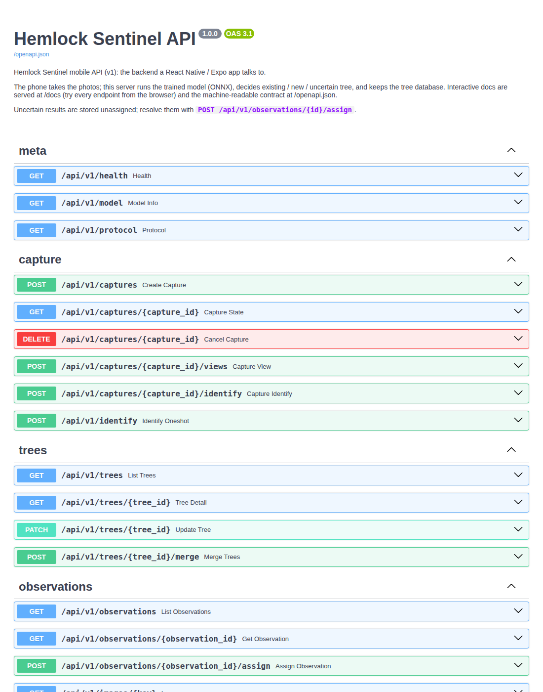

# Hemlock Sentinel API (backend for the mobile app)

The phone app (React Native / Expo) takes the photos and shows results. This
backend runs the trained model and keeps the tree database:

```
 phone (React Native)                      backend (this repo, Python)
 ───────────────────                       ───────────────────────────────────────────
 camera, GPS, compass   ── photos ──▶      quality checks, face blur
 guided capture screens                    DINOv2-S model (models/production/hemlock.onnx)
 results, tree history  ◀── JSON ───       species gate → match against every stored tree
 review queue                              existing / new / uncertain decision
                                           SQLite database + original photos
```

Model: production **v2** (`hemlock-dino_plus_recapture-20261007`), 87 MB ONNX, CPU only.
Decision thresholds: `models/production/calibration.json` (fitted on validation trees).

## Run it

**Option A: Python** (Python 3.10+)

```bash
git clone -b backend/api https://github.com/ekaagar-chawla-19/Congressional-App-Challenge-2026
cd Congressional-App-Challenge-2026
python -m pip install -e ".[onnx,app]"
hemlock-api                 # → http://localhost:8000/docs
```

**Option B: Docker**

```bash
docker build -t hemlock-api .
docker run -p 8000:8000 -v hemlock-data:/data hemlock-api      # → http://localhost:8000/docs
```

Open **http://localhost:8000/docs**: every endpoint can be tried from the
browser ("Try it out" → choose photos → "Execute"). Start with
`POST /api/v1/identify` and three trunk photos of one tree, then send three
other photos of the same tree: the second call should say `"status": "existing"`
with the same `tree_id`.



Settings (flags or environment variables):

| Flag | Env | Default |
|---|---|---|
| `--db` | `HEMLOCK_DB` | `runs/api/trees.sqlite` |
| `--blobs` | `HEMLOCK_BLOBS` | `runs/api/blobs` (photos) |
| `--model` / `--calibration` | `HEMLOCK_MODEL` / `HEMLOCK_CALIBRATION` | `models/production/…` |
| `--port` | `PORT` | `8000` |
| `--cors` | `HEMLOCK_CORS` | `*` |
| `--demo` | | off (mock model, results meaningless; for UI work without the model) |
| | `HEMLOCK_API_KEY` | unset = no auth; set = every `/api/v1/*` call except `/health` needs header `X-API-Key` |

### Reaching it from a phone

The phone and the computer running the backend must be on the same Wi-Fi.
Use the computer's LAN address, e.g. `http://192.168.1.20:8000` (find it with
`ipconfig` on Windows, `ipconfig getifaddr en0` on macOS). Plain `http://`
works in Expo Go during development. A release build needs HTTPS (iOS) or
`usesCleartextTraffic` (Android). For testing away from home Wi-Fi, a tunnel
such as `ngrok http 8000` gives an HTTPS URL; set `HEMLOCK_API_KEY` first,
since the tunnel URL is public.

## TypeScript client (for the React Native app)

`client/` is a dependency-free TypeScript client whose types are generated from
this server's OpenAPI spec, so the app and backend cannot silently disagree.

```bash
cd client && npm install && npm run build
# in the app:  npm install ../path/to/client
```

```ts
import { HemlockClient, HemlockApiError } from "@hemlock-sentinel/client";

const api = new HemlockClient({ baseUrl: "http://192.168.1.20:8000" });

// One-shot: three trunk photos (north side first, then quarter-turns clockwise)
const r = await api.identify(
  [{ uri: north.uri }, { uri: right.uri }, { uri: right2.uri }],   // expo-camera / image-picker results
  { location: { lat, lon, accuracy_m }, headings: [5, 95, 182] },
);
switch (r.action) {
  case "done":   show(`${r.species?.name}: ${r.tree_id}`, r.probability); break;      // existing or new
  case "review": pickFrom(r.candidates, (treeId) => api.assignObservation(r.observation_id!, treeId)); break;
  case "retake": showProblems(r.views.filter((v) => !v.accepted)); break;
}

// Tree list with thumbnails
const { items } = await api.listTrees();
<Image source={api.imageSource(items[0].thumbnail_url!)} />
```

Errors throw `HemlockApiError` with `.status`, `.code` (stable, e.g.
`tree_not_found`, `bad_image`, `network_error`) and a readable `.message`.

Check the client against a running backend: `npm run test:live -- photo1.jpg … photo6.jpg`
(6 photos of one tree: enrols with 3, revisits with the other 3).

## The two ways to identify a tree

**One-shot** (`POST /api/v1/identify`): all 3–7 photos in one request.
Simplest. The result is always stored (uncertain ones go to the review queue);
`commit=false` is a dry run.

**Guided** (`/captures`): one photo at a time with instant feedback, which is
what the field protocol needs:

```
POST /captures                         → capture_id, next_view (instructions to show)
POST /captures/{id}/views   (photo)    → view.accepted? problems ("too blurry", "same as view 1: move…"),
                                         next_view, can_identify
   … repeat until can_identify …
POST /captures/{id}/identify           → action:
     "done"                  stored; status "existing" (tree_id) or "new" (new tree_id)
     "capture_another_view"  views disagreed: take next_view, then identify again
     "review"                stored unassigned: user picks from candidates
     "retake"                fewer than 3 good trunk photos
```

Uncertain cases are never merged automatically. Two user actions fix the database:

* `POST /observations/{id}/assign {"tree_id": "H-004"}` (or `"new"`): resolve a
  review item, or correct a wrong automatic match with one tap.
* `POST /trees/{id}/merge {"duplicate_tree_id": "H-009"}`: fold a duplicate tree in.

Retired tree IDs are never reused.

## Endpoints

| Method | Path | Purpose |
|---|---|---|
| GET | `/api/v1/health` | liveness, model version, face blur active (no key needed) |
| GET | `/api/v1/model` | model version, species, calibration provenance |
| GET | `/api/v1/protocol` | the guided photo sequence and its instructions |
| POST | `/api/v1/captures` | start a guided capture (held in memory 30 min) |
| GET | `/api/v1/captures/{id}` | capture state |
| POST | `/api/v1/captures/{id}/views` | add one photo (`image`, optional `view_key`, `heading_deg`) |
| POST | `/api/v1/captures/{id}/identify` | decide; JSON body `{force_commit?, location?}` |
| DELETE | `/api/v1/captures/{id}` | cancel |
| POST | `/api/v1/identify` | one-shot (`images[]`, optional `view_keys`, `headings`, `lat`, `lon`, `accuracy_m`, `commit`) |
| GET | `/api/v1/trees` | trees, most recently seen first (`species`, `limit`, `offset`) |
| GET | `/api/v1/trees/{id}` | a tree and its full observation history |
| PATCH | `/api/v1/trees/{id}` | `{notes}` |
| POST | `/api/v1/trees/{id}/merge` | `{duplicate_tree_id}` |
| GET | `/api/v1/observations` | `status` (repeatable), `unassigned`, paging; review queue = `?status=uncertain&unassigned=true` |
| GET | `/api/v1/observations/{id}` | one observation |
| POST | `/api/v1/observations/{id}/assign` | `{tree_id}`: existing ID or `"new"` |
| GET | `/api/v1/images/{key}` | stored photo (JPEG, cacheable forever) |

Full schemas: `/docs` on a running server, or [`docs/api/openapi.json`](api/openapi.json).

All errors have one shape, `{"error": {"code": "...", "message": "..."}}`:
`400` bad input (`bad_image`, `unknown_view`, `wrong_view_count`, `species_mismatch`, …),
`401` `unauthorized`, `404` `*_not_found`, `409` `tree_merged` / `capture_finished`,
`413` `image_too_large` (25 MB per photo), `422` `invalid_request`.

## What the numbers mean (show these honestly in the app)

* `species.confidence`: species gate. Re-identification only runs for Eastern
  hemlock above the validated threshold (test: hemlock precision 1.00, recall 0.97;
  0 of 236 never-seen red spruce photos called hemlock).
* `probability`: calibrated probability that `tree_id` is the right tree. Automatic
  matches require ≥ 0.93 (thresholds set for a 1 % false-match rate on validation trees).
* `candidates`: top 5 trees with scores, for the "is it one of these?" screen.
* Expect the right tree at the top of the list 87 % of the time for hemlocks on
  BarkNet test trees and 99–100 % for re-photographed bark patches. Different-day
  re-identification of hemlocks has not been measured yet (docs/experiments.md).
  The thresholds come from BarkNet cameras: recalibrate on the team's own field data
  (README, "Collecting the team's own dataset").

## Tests

```bash
pytest tests/integration/test_api_v1.py            # API with a mock model (fast)
pytest tests/end_to_end/test_api_real_model.py     # production model on held-out BarkNet trees
python scripts/export_openapi.py && (cd client && npm run gen && npm run typecheck)   # after API changes
```
