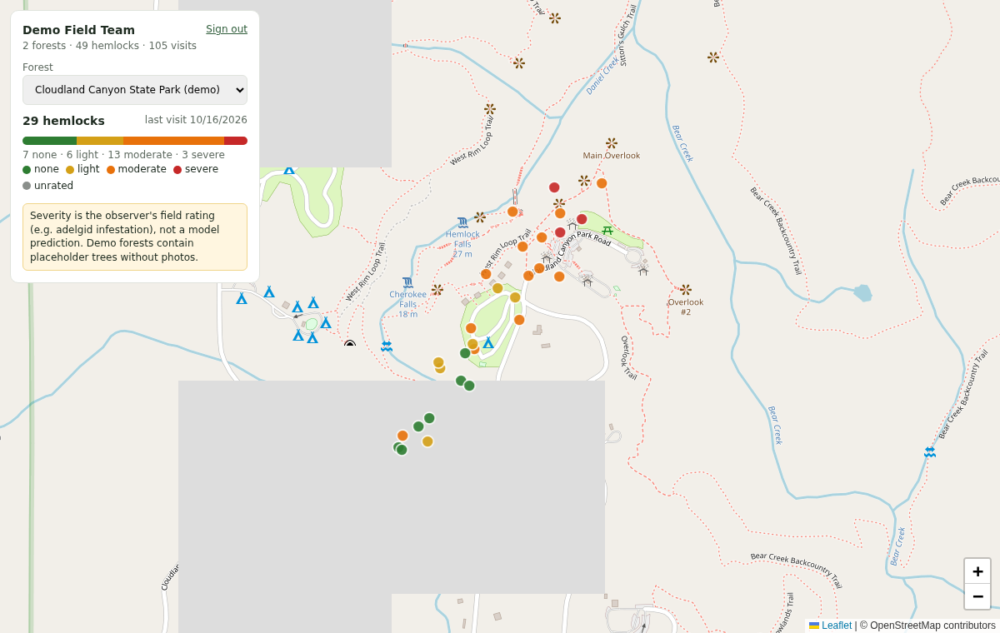

# Hemlock Sentinel API (backend for the mobile app and the ESP32 sensor node)

The phone app (React Native / Expo) takes the photos and reads the ESP32 sensor node
over Bluetooth LE. This backend runs the trained model and keeps each account's forests
and trees:

```
 ESP32 sensor node ─ BLE ─▶ phone (React Native) ── photos + readings, HTTP ──▶ hemlock-api (this repo, Python)
 (soil, temp, humidity,                                                         ▲
  light; no camera)  └──── optional: Wi-Fi POST of readings for one tree ──────┘
                                                              • sign-in, forests (one tree database per forest)
                                                              • quality checks, face blur
                                                              • DINOv2-S model (models/production/hemlock.onnx)
                                                              • species gate → match against the forest's trees
                                                              • existing / new / uncertain, severity ratings
                                                              • forest map (GeoJSON + /map page)
```

Model: production **v2** (`hemlock-dino_plus_recapture-20261007`), 87 MB ONNX, CPU only.
Decision thresholds: `models/production/calibration.json` (fitted on validation trees).

**Severity is not predicted by the model.** The model identifies species and
individual trees. Severity (0 none, 1 light, 2 moderate, 3 severe, e.g. hemlock
woolly adelgid infestation) is the observer's rating, sent with the photos or
set later. The map shows each tree's most recent rating.

## Try it on your phone (the app at /app)

```bash
python -m pip install -e ".[onnx,app,assistant]"
export ANTHROPIC_API_KEY=sk-ant-...      # optional: enables the AI assistant + AI photo check
hemlock-api
```

On the computer: http://localhost:8000/app. On your phone (same Wi-Fi): http://<computer-ip>:8000/app
(macOS: `ipconfig getifaddr en0`). Sign in with `demo@hemlock.test` / `hemlock-demo`. The camera
works through the photo buttons over plain http; "Use my location" needs HTTPS on phones, so type
the coordinates or use a tunnel (`ngrok http 8000`).

Screens: forests → forest (Map colored by severity / main condition / sections, "Analyze visible
area", Sections ranked worst first, Trees, Insights with recommendations) → tree (current health
with evidence, latest ESP32 reading, every visit with photos / sensors / signs / assessment, `N/A`
where a visit had none) → Survey tree (3 trunk photos + optional twig close-up, severity, signs,
ESP32 readings) → result (existing / new / not sure: "Use H-004 (71%)" best guess, other candidates,
or new tree) → Ask AI.

## Tree health: what is assessed and how sure it can be

Three threats, from the research in [`docs/research/hemlock_health.md`](research/hemlock_health.md):
hemlock woolly adelgid (HWA), elongate hemlock scale (EHS), and drought stress with secondary
decline (root rot, borers). Each visit gets a finding per condition: `likely` / `possible` / `low`
with a 0–1 likelihood and the evidence, or `unknown`.

| Evidence | What it can show |
|---|---|
| Observer signs (checklist) | Confirms HWA (wool at needle bases) and EHS (scale covers) — the only reliable way |
| Twig-underside close-up + AI photo check | Suggests wool/scales; capped at "possible" until a person confirms |
| Trunk-bark photos (identity model) | Cannot show HWA or EHS → they stay `unknown`, never "healthy"; can show borer holes / root rot when ticked |
| ESP32 soil moisture, temperature, humidity (VPD) | Drought stress risk only; never diagnoses a pest. DHT11 can't read below 0 °C |
| ESP32 light | Flags visits too dark to trust visual checks |

Recommendations never include pesticide doses: they point to the label, licensed applicators,
the Georgia Forestry Commission, UGA Extension and Save Georgia's Hemlocks. Thresholds are
heuristic and documented as such.

## AI assistant

`POST /api/v1/assistant/chat {message, conversation_id?, forest_id?, tree_id?}` → Claude Haiku
(`claude-haiku-5-5`, adaptive thinking) with read-only tools over the signed-in user's own data
(account overview, forest analysis, ranked sections, tree lists, a tree's full history, the health
guide). It cannot see other accounts. It needs `ANTHROPIC_API_KEY` from console.anthropic.com
(pay per use; Haiku is the cheapest model); without it the endpoint returns
`503 assistant_not_configured` and the app says so. A Claude.ai subscription cannot be used for this.

## Where the model runs: computer or phone

The same model file (`hemlock.onnx`) runs in both places, with the same preprocessing, thresholds
and decision logic:

| | Computer (server) | Phone (on-device) |
|---|---|---|
| Runtime | ONNX Runtime (Python) | ONNX Runtime JS: `onnxruntime-web` (the `/app` web app), `onnxruntime-react-native` (RN app) |
| Code | `src/hemlock_sentinel/pipeline` | `client/src/ondevice.ts` (a port of the server pipeline) |
| Needs signal | yes | no, after the model (87 MB, once) and the forest's trees are downloaded |
| Stores the result | yes, assigns tree IDs | no: offline surveys are queued and sent with "Sync now"; the server then stores them and makes the final call |

Parity, checked by `client/test/parity.mjs` on 11 captures of held-out BarkNet hemlocks (8 returning
trees, 3 never enrolled): **11/11 identical decisions**, embeddings cosine ≥ 0.994 to the server's,
match probabilities within 0.02. Not ported: the "no tree structure visible" edge check and face
blurring (the server still does both on sync).

In the web app: Survey tree → tick **Run the model on this phone**. The model is stored in the
browser (IndexedDB) and re-downloaded only when the server's model changes (SHA-256 check). The
page itself must already be open when signal is lost (offline loading of the page would need
HTTPS and a service worker).

API for on-device use: `GET /api/v1/model` (`on_device`: URLs, size, SHA-256),
`GET /api/v1/model/files/hemlock.onnx`, `.../hemlock.json`, `GET /api/v1/model/calibration`,
`GET /api/v1/gallery` (the forest's tree fingerprints, X-Forest-Id).

React Native:

```ts
import * as ort from "onnxruntime-react-native";
import { HemlockClient, OnDeviceModel } from "@hemlock-sentinel/client";

const files = await api.downloadModel();            // save files.onnx to the app's documents dir (expo-file-system)
const model = await OnDeviceModel.create(ort, modelFileUri, files.meta, files.calibration, {});
const gallery = await api.gallery();                // cache per forest for offline use
const views = [];
for (const [key, img] of photos) views.push(await model.processView(img, key, views));  // img: { width, height, data: RGBA, channels: 4 }
const result = model.identify(views, gallery);      // existing / new / uncertain, like POST /identify
```

Speed: about 0.3 s per photo with ONNX Runtime on a laptop CPU (Node). Phones running the web
build use WebAssembly and are slower (expect a few seconds per photo); the React Native build can
use the phone's native ONNX Runtime and is faster. Not yet measured on a real phone.

## Run it

**Option A: Python** (Python 3.10+)

```bash
git clone https://github.com/ekaagar-chawla-19/Congressional-App-Challenge-2026
cd Congressional-App-Challenge-2026
python -m pip install -e ".[onnx,app]"
hemlock-api            # → http://localhost:8000/map  (sign in: demo@hemlock.test / hemlock-demo)
                       #   http://localhost:8000/docs (try every endpoint)
```

**Option B: Docker**

```bash
docker build -t hemlock-api .
docker run -p 8000:8000 -v hemlock-data:/data hemlock-api
```

On first start a **demo account** is created (`demo@hemlock.test` / `hemlock-demo`,
skip with `--no-demo-account`) with two North Georgia demo forests (Cloudland Canyon, and Cooper Creek in the Chattahoochee NF) full of
**placeholder** hemlocks (positions, visit dates and severity ratings, no photos)
so the account overview and map have something to show. Photos you capture
while signed in as the demo user are real and stored normally.



`/map` is a demo page to show the backend working (sign in → pick a forest →
every hemlock colored by severity; click one for its history and photo). The
real app UI is the React Native frontend.

In `/docs`: call `POST /api/v1/auth/login`, copy the `token`, click **Authorize**
(top right) and paste it; then fill `x-forest-id` (the forest number from
`GET /api/v1/forests`) on tree, capture and identify calls. The TypeScript client
does all of this for you.

Settings (flags or environment variables):

| Flag | Env | Default |
|---|---|---|
| `--data` | `HEMLOCK_DATA` | `runs/api` (accounts + one folder per forest) |
| `--no-demo-account` | | demo account is created |
| `--single` | | off: accounts + forests. On: one shared database, no sign-in (`--db`, `--blobs`) |
| `--model` / `--calibration` | `HEMLOCK_MODEL` / `HEMLOCK_CALIBRATION` | `models/production/…` |
| `--port` | `PORT` | `8000` |
| `--cors` | `HEMLOCK_CORS` | `*` |
| `--demo` | | off (mock model, results meaningless; for UI work without the model) |
| | `HEMLOCK_API_KEY` | unset; set = every `/api/v1/*` call except `/health` also needs `X-API-Key` |

### Sign-in and forests

```
POST /auth/register {email, password (8+), name}   → {token, user}
POST /auth/login    {email, password}               → {token, user}
then on every call:  Authorization: Bearer <token>
GET  /me             → the whole account: every forest with tree count, visits, severity breakdown
POST /forests        {name, lat?, lon?}
then on tree / capture / identify / map calls:  X-Forest-Id: <forest_id>
```

Each forest is a separate tree database: IDs (`H-001`, …) are per forest, and a
capture is only matched against trees of the forest it is sent to. Nobody can
read or write another account's forests (tested). This is demo-grade sign-in
(scrypt-hashed passwords, 30-day tokens): add HTTPS, rate limiting and password
reset before real deployment.

### Reaching it from a phone

The phone and the computer running the backend must be on the same Wi-Fi.
Use the computer's LAN address, e.g. `http://192.168.1.20:8000` (find it with
`ipconfig` on Windows, `ipconfig getifaddr en0` on macOS). Plain `http://`
works in Expo Go during development. A release build needs HTTPS (iOS) or
`usesCleartextTraffic` (Android). For testing away from home Wi-Fi, a tunnel
such as `ngrok http 8000` gives an HTTPS URL.

## ESP32 sensor node

The ESP32 replaces the Raspberry Pi. It reads the field sensors; the phone takes the photos and the
model runs on the computer with the backend. Firmware: [`firmware/esp32_sensors/esp32_sensors.ino`](../firmware/esp32_sensors/esp32_sensors.ino)
(Arduino; checked to compile for "ESP32 Dev Module", esp32 core 3.0.7).

| Sensor | Pin | Notes |
|---|---|---|
| Capacitive soil-moisture probe | GPIO34 (ADC1) | calibrate `SOIL_RAW_DRY` (in air) / `SOIL_RAW_WET` (in water) |
| DHT11 temperature + humidity | GPIO4 | 0–50 °C ±2 °C, 20–90 % RH ±5 %: cannot see winter lows |
| BH1750 light | SDA 21 / SCL 22 | lux |

Flash it: Arduino IDE → Boards Manager "esp32" (Espressif) → board "ESP32 Dev Module"; Library
Manager: "DHT sensor library", "Adafruit Unified Sensor", "BH1750" → Upload. The Serial Monitor
(115200) prints a JSON line every 10 s; type `r` to read now:

```json
{"v":1,"device":"HS-ESP32-1A2B","soil_moisture_pct":23.4,"air_temp_c":21.0,"humidity_pct":64,"light_lux":5400,"soil_raw":2210,"uptime_s":42}
```

A failed sensor is `null` → stored and shown as N/A. Three ways to get readings into the app:

1. **Phone over Bluetooth LE (main path).** The node advertises as `HS-ESP32-xxxx` with service
   `6e1f0001-6d6c-4f2b-9a35-1c3a5e6b7d01`: write `r` to `…0003` (measure now), wait ~3 s, read the
   JSON from `…0002` (also notified). The phone sends the values with the photos
   (`POST /identify` fields `soil_moisture_pct`, `air_temp_c`, `humidity_pct`, `light_lux`) or
   alone (`POST /trees/{id}/visits`). React Native: `client/src/esp32.ts` has the UUIDs and
   `parseEsp32Reading()` for `react-native-ble-plx`. The demo web app's "Read ESP32 sensors" button
   uses Web Bluetooth: Chrome on Android or a laptop, over https or localhost (iPhone Safari has
   no Web Bluetooth; use the Bluefy browser or type the values).
2. **Laptop:** `pip install -e ".[esp32]"`, then
   ```bash
   hemlock-esp32 scan
   hemlock-esp32 read                                  # Bluetooth (macOS, Windows, Linux)
   hemlock-esp32 read --serial /dev/cu.usbserial-0001  # USB cable
   hemlock-esp32 visit H-012 --forest 1 --email demo@hemlock.test --password hemlock-demo
   hemlock-esp32 identify p1.jpg p2.jpg p3.jpg --forest 1 --email ... --password ... --lat 34.83 --lon -85.48
   ```
3. **Wi-Fi upload (optional, a node left at one tree):** set `WIFI_UPLOAD 1`, Wi-Fi name/password,
   `API_BASE`, `TREE_ID`, `FOREST_ID` and a token from `POST /api/v1/auth/login` (valid 30 days) in
   the sketch, and choose Partition Scheme "Huge APP" (BLE + Wi-Fi don't fit the default layout).
   It posts `{"sensors": <reading>}` to `/trees/{TREE_ID}/visits` every hour.

Tested here: the reading format, USB and BLE reading logic (with fake transports), the exact
Wi-Fi upload payload against the API, and `hemlock-esp32` against a live backend. **Not tested on a
real ESP32 or real sensors** (none available in this environment).

## TypeScript client (for the React Native app)

`client/` is a dependency-free TypeScript client whose types are generated from
this server's OpenAPI spec, so the app and backend cannot silently disagree.

```bash
cd client && npm install && npm run build
# in the app:  npm install ../path/to/client
```

```ts
import { HemlockClient, HemlockApiError } from "@hemlock-sentinel/client";

const api = new HemlockClient({ baseUrl: "http://192.168.1.20:8000" });
await api.login(email, password);              // keeps the token (persist it with expo-secure-store)
const account = await api.me();                // forests, tree counts, severity breakdown
api.setForest(account.forests[0].forest_id);

// three trunk photos (north side first, then quarter-turns clockwise) + the observer's severity rating
const r = await api.identify(
  [{ uri: north.uri }, { uri: right.uri }, { uri: right2.uri }],   // expo-camera / image-picker results
  { location: { lat, lon, accuracy_m }, severity: 2, healthNotes: "wool on lower branches" },
);
switch (r.action) {
  case "done":   show(`${r.species?.name}: ${r.tree_id}`, r.probability); break;      // existing or new
  case "review": pickFrom(r.candidates, (treeId) => api.assignObservation(r.observation_id!, treeId)); break;
  case "retake": showProblems(r.views.filter((v) => !v.accepted)); break;
}

// map: GeoJSON points with severity → react-native-maps <Marker>s
const map = await api.forestMap();
map.features.map((f) => ({ id: f.properties.tree_id, lat: f.geometry.coordinates[1],
                           lon: f.geometry.coordinates[0], severity: f.properties.severity_label }));

<Image source={api.imageSource(tree.thumbnail_url!)} />   // includes sign-in headers
```

Errors throw `HemlockApiError` with `.status`, `.code` (stable, e.g.
`not_signed_in`, `forest_required`, `tree_not_found`, `bad_image`, `network_error`)
and a readable `.message`.

Check the client against a running backend: `npm run test:live -- photo1.jpg … photo6.jpg`
(6 photos of one tree: signs in to the demo account, creates a test forest,
enrols with 3, revisits with the other 3, checks severity and the map).

## The two ways to identify a tree

**One-shot** (`POST /api/v1/identify`): all 3–7 photos in one request.
Simplest. The result is always stored (uncertain ones go to the review queue);
`commit=false` is a dry run.

**Guided** (`/captures`): one photo at a time with instant feedback, which is
what the field protocol needs:

```
POST /captures                         → capture_id, next_view (instructions to show)
POST /captures/{id}/views   (photo)    → view.accepted? problems ("too blurry", "same as view 1: move…"),
                                         next_view, can_identify
   … repeat until can_identify …
POST /captures/{id}/identify           → action:
     "done"                  stored; status "existing" (tree_id) or "new" (new tree_id)
     "capture_another_view"  views disagreed: take next_view, then identify again
     "review"                stored unassigned: user picks from candidates
     "retake"                fewer than 3 good trunk photos
```

Uncertain cases are never merged automatically. Two user actions fix the database:

* `POST /observations/{id}/assign {"tree_id": "H-004"}` (or `"new"`): resolve a
  review item, or correct a wrong automatic match with one tap.
* `POST /trees/{id}/merge {"duplicate_tree_id": "H-009"}`: fold a duplicate tree in.

Retired tree IDs are never reused.

## Endpoints

All under `/api/v1`. **Forest** = needs `X-Forest-Id` (accounts mode).

| Method | Path | Purpose |
|---|---|---|
| GET | `/health` | liveness, model version, face blur active (no sign-in) |
| GET | `/model` | model version, species, calibration provenance |
| GET | `/protocol` | the guided photo sequence and its instructions |
| POST | `/auth/register`, `/auth/login` | → token |
| POST | `/auth/logout` | revoke the token |
| GET | `/me` | the account: every forest with tree count, visits, severity breakdown |
| GET / POST | `/forests` | list / create |
| GET | `/forests/{id}` | one forest's summary |
| DELETE | `/forests/{id}?confirm_name=` | delete a forest and everything in it; `confirm_name` must be its exact name (`400 name_mismatch` otherwise) |
| GET | `/forests/{id}/map` | GeoJSON: every tree with location and latest severity |
| GET | `/map` | same, for the current forest (**forest**) |
| POST | `/captures` | start a guided capture (held in memory 30 min) (**forest**) |
| GET | `/captures/{id}` | capture state |
| POST | `/captures/{id}/views` | add one photo (`image`, optional `view_key`, `heading_deg`) |
| POST | `/captures/{id}/identify` | decide; JSON `{force_commit?, location?, severity?, health_notes?}` |
| DELETE | `/captures/{id}` | cancel |
| POST | `/identify` | one-shot (`images[]`, optional `view_keys`, `headings`, `lat`, `lon`, `accuracy_m`, `severity`, `health_notes`, `commit`) (**forest**) |
| GET | `/trees` | trees with latest severity and location, most recently seen first (**forest**) |
| GET | `/trees/{id}` | a tree and its full history (severity per visit) |
| PATCH | `/trees/{id}` | `{notes}` |
| DELETE | `/trees/{id}` | delete a tree with its visits, health records, sensor readings and photos (ID never reused) |
| POST | `/trees/{id}/merge` | `{duplicate_tree_id}` |
| GET | `/observations` | `status` (repeatable), `unassigned`, paging; review queue = `?status=uncertain&unassigned=true` |
| GET | `/observations/{id}` | one observation |
| PUT | `/observations/{id}/health` | `{severity, notes}` |
| POST | `/observations/{id}/assign` | `{tree_id}`: existing ID or `"new"` |
| GET | `/images/{key}` | stored photo (JPEG) (**forest**) |
| POST | `/species-check` | is this a hemlock? one `image` through the species model; nothing stored (**forest**) |
| GET | `/analysis` | the forest, or an area `?west=&south=&east=&north=`: summary, conditions, `hotspots` per condition, quarterly `trends`, `sections`, worst trees, advice (**forest**) |
| GET / POST | `/sections` | named areas of the forest with their summary; create `{name, west, south, east, north}` (**forest**) |
| GET | `/sections/{id}/analysis` | the analysis above for one section |
| DELETE | `/sections/{id}` | remove a section |
| GET | `/landmarks` | GeoJSON streams, ridges, peaks, trails (demo Chattahoochee forest; approximate) |

Every photo checked by `/captures/{id}/views` also reports `hemlock_probability` and `top_species`
(that photo alone) and a `texture_coverage` metric with a "too far" / "almost" distance warning,
which the phone app turns into coaching ("Okay, you're close. I need you to get this close…").

Full schemas: `/docs` on a running server, or [`docs/api/openapi.json`](api/openapi.json).

All errors have one shape, `{"error": {"code": "...", "message": "..."}}`:
`400` bad input (`bad_image`, `forest_required`, `unknown_view`, `wrong_view_count`, …),
`401` `not_signed_in` / `bad_credentials`, `404` `*_not_found`, `409` `email_taken` /
`forest_exists` / `tree_merged` / `capture_finished`, `413` `image_too_large` (25 MB per photo),
`422` `invalid_request`.

## What the numbers mean (show these honestly in the app)

* `species.confidence`: species gate. Re-identification only runs for Eastern
  hemlock above the validated threshold (test: hemlock precision 1.00, recall 0.97;
  0 of 236 never-seen red spruce photos called hemlock).
* `probability`: calibrated probability that `tree_id` is the right tree. Automatic
  matches require ≥ 0.93 (thresholds set for a 1 % false-match rate on validation trees).
* `candidates`: top 5 trees with scores, for the "is it one of these?" screen.
* `severity`: the observer's rating, not a model output.
* Expect the right tree at the top of the list 87 % of the time for hemlocks on
  BarkNet test trees and 99–100 % for re-photographed bark patches. Different-day
  re-identification of hemlocks has not been measured yet (docs/experiments.md).
  The thresholds come from BarkNet cameras: recalibrate on the team's own field data
  (README, "Collecting the team's own dataset").

## Tests

```bash
pytest tests/integration/test_api_v1.py tests/integration/test_accounts_forests.py \
       tests/integration/test_field_health.py tests/integration/test_esp32.py   # mock model, fast
pytest tests/end_to_end/test_api_real_model.py           # production model on held-out BarkNet trees
python scripts/export_openapi.py && (cd client && npm run gen && npm run typecheck)   # after API changes
```
